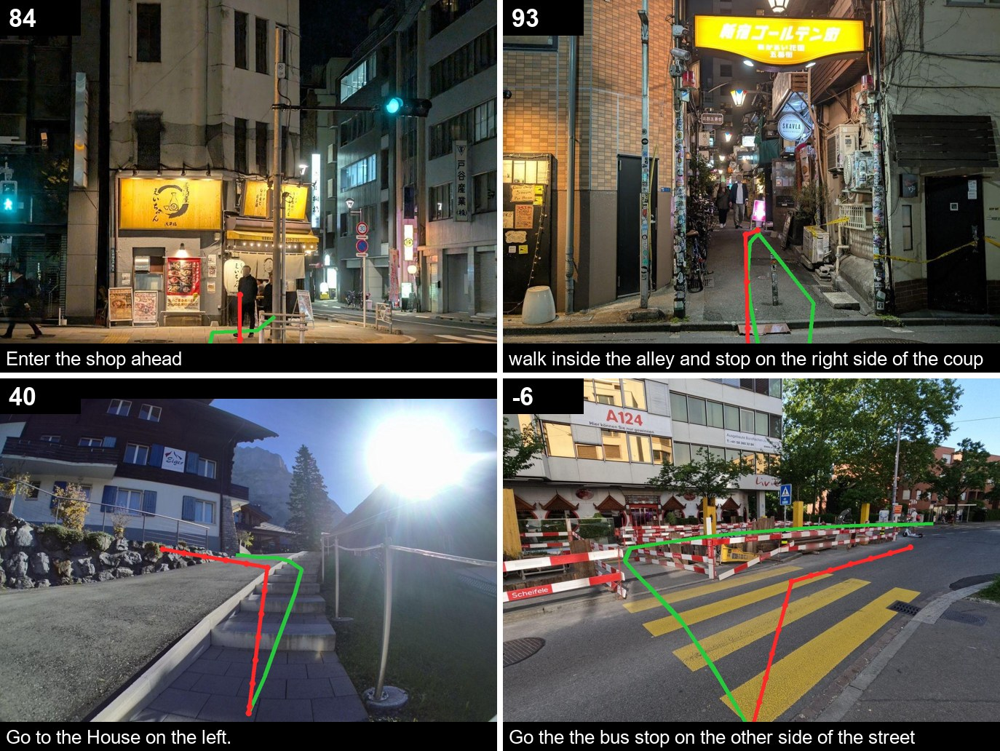
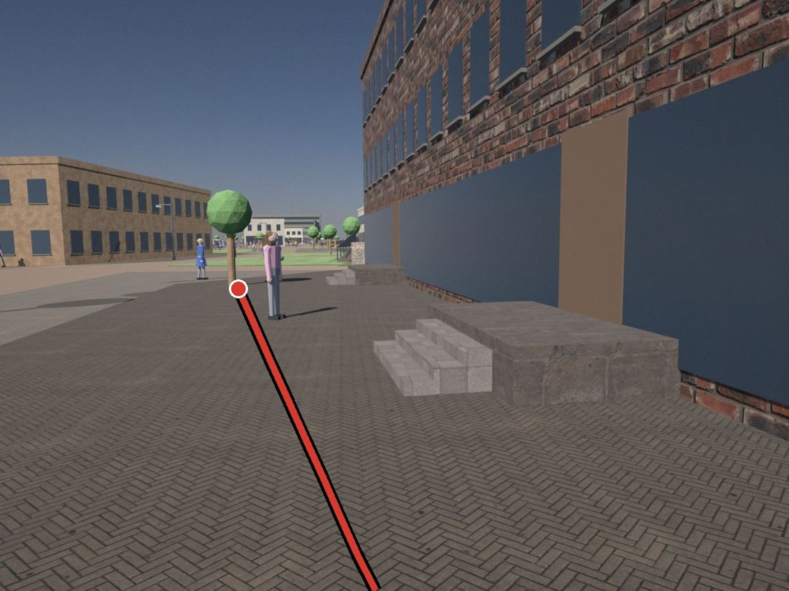

# Masar

Masar is a vision-language model that takes a first-person outdoor photo and an instruction such
as *"Go to the bench on the left"* and draws the path a person would walk. It is trained only on
synthetic scenes rendered in Blender.





| | Link |
|---|---|
| Project page and demo | https://ahedmousa1-crypto.github.io/masar |
| Model | https://huggingface.co/ahd03/masar |
| Dataset | https://huggingface.co/datasets/ahd03/vln-synthetic-scenes |

## Results

Scores on the 500 Human scenarios of the [NaviTrace](https://huggingface.co/datasets/leggedrobotics/navitrace)
validation split, using NaviTrace's scoring code. 0 is walking straight ahead and 100 is the expert path.

| Category | Before training | Masar |
|---|---:|---:|
| **Overall** | **-28.3** | **36.9** |
| Dynamic Obstacle | -25.0 | 50.5 |
| Stationary Obstacle | -23.7 | 41.1 |
| Semantic Terrain | -24.0 | 39.7 |
| Geometric Terrain | -27.8 | 36.1 |
| Accessibility | -34.1 | 32.8 |
| Visibility | -27.6 | 30.3 |
| Social Norms | -59.8 | 24.1 |

For reference, Human-only means on the NaviTrace leaderboard are 75.5 for a human expert, 35.4 for
Gemini 2.5 Pro, 21.1 for GPT-5 and 19.3 for Qwen3-VL-235B. Those are measured on the hidden test
split. Masar is measured on the validation split and has not been submitted.

## How it works

1. A script builds an outdoor scene in Blender and labels every surface.
2. Cameras are placed at eye height on walkable ground.
3. A route planner computes the walking path to each target and projects it into the image.
4. Blender renders the image and a segmentation mask. The sample is checked and uploaded.

The base model is Qwen3-VL-8B-Instruct, fine-tuned with LoRA on the rendered samples.

## Repository layout

```
blender/
  build_world.py        build a scene
  place_views.py        place cameras
  render_views.py       render cameras into samples (image, mask, tasks, paths)
  worldlib/             layouts, geometry, props, materials, lighting, planner, tasks
  assets/LICENSES.md    credits for downloaded CC0 assets
tools/
  fetch_assets.py       download CC0 skies, textures and meshes
  render_batches.py     render, check and upload in batches
  build_dataset.py      class masks, checks, camera effects
  upload_batch.py       upload a batch to the Hub
  modal_render.py       render on Modal GPUs
  export_hf.py          one-shot Hugging Face export of a local dataset
  update_numbers.py     fill the README and the Hub cards from docs/results.json
finetune/
  modal_app.py          train, predict and score on Modal
  prompts.py            NaviTrace's prompts and the answer format
  synthetic_classes.py  class ids mapped to NaviTrace categories
  navitrace_eval/       NaviTrace's scoring code (MIT, ETH Zurich)
cards/                  sources of this README and the Hub cards
demo/modal_demo.py      the endpoint behind the demo
docs/                   the project page
trace_format.py         pixel-trace helpers
```

## Run it

Requirements are Blender 5.2, Python 3.10+ with `numpy`, `Pillow`, `pyarrow`, `datasets` and
`huggingface_hub`, and a [Modal](https://modal.com) account for training and cloud rendering.

```bash
python tools/fetch_assets.py
blender -b --python blender/build_world.py -- --world campus
blender -b blender/world_campus/world.blend --python blender/place_views.py -- --count 2800
python tools/render_batches.py --world campus --max_tasks 3 --repo <user>/<dataset>   # locally
modal run --detach tools/modal_render.py --step full                                 # or on Modal

modal run finetune/modal_app.py --step prepare
modal run finetune/modal_app.py --step train --run v1 --epochs 2
modal run finetune/modal_app.py --step predict --run v1 --adapter v1
modal run finetune/modal_app.py --step score --run v1
modal deploy demo/modal_demo.py
```

## Credits and licenses

- Code is MIT. The dataset is CC BY 4.0. The Masar adapter is Apache 2.0.
- [NaviTrace](https://arxiv.org/abs/2510.26909) (Windecker et al., 2025) for the benchmark, prompts, scoring code and categories.
- [Qwen3-VL-8B-Instruct](https://huggingface.co/Qwen/Qwen3-VL-8B-Instruct) (Apache 2.0) as the base model.
- [Blender](https://www.blender.org), [Poly Haven](https://polyhaven.com) skies and textures (CC0), [Quaternius](https://opengameart.org/content/animated-animales-low-poly) animal meshes (CC0).
